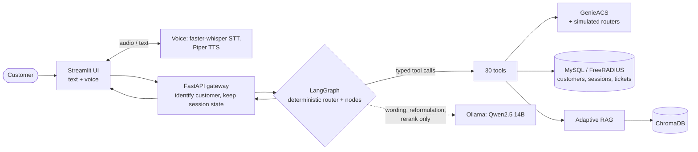

# ISPilot

A first-line technical-support agent for internet service providers: it diagnoses a customer's problem from live router and subscriber data, applies fixes through typed tools, and replies in text or voice, with a local LLM that only phrases the answer and never decides the action.

> Built as an end-of-studies project. **Everything in this repository runs on synthetic data**: no real customers, devices, prices or documents.

## The problem

When an ISP customer says "my internet doesn't work", a first-line agent has to answer a fixed set of questions before touching anything: is the account active, is there a regional outage, are authentication requests being rejected, is the router online, is the line quality acceptable? Only then does it pick a fix (reboot, resync credentials, change MTU, disconnect a stale session) or escalate to a technician.

A free-running LLM agent is risky in this setting. It can pick the wrong action (a factory reset resets the customer's Wi-Fi and credentials), claim it did something it did not do, quote a speed or price it made up, or skip the escalation rule. Support logs are also an audit trail: "the system said it rebooted the router" has to be true. ISPilot therefore puts the decisions in code and uses the LLM only for language.

## Key features

- **Deterministic orchestration.** A LangGraph state machine routes each message with explicit rules. A dozen named scenarios (authentication failure, stale session, quota exhausted, marginal or critical SNR, obsolete firmware, MTU mismatch, Wi-Fi confusion, slow speed, high latency, physical offline, plan upgrade) each map to a fixed intervention sequence.
- **Diagnose before acting.** Each problem starts with a fresh snapshot: session history, authentication failures, device status and parameters, plan, regional outage check.
- **Typed tools.** 30 LangChain tools across four families: device management (GenieACS / TR-069), subscribers and sessions (FreeRADIUS / MySQL), business operations (accounts, outages, plans, tickets), and knowledge retrieval.
- **Confirm-then-execute.** Factory reset and plan upgrade are applied only after the customer explicitly says yes.
- **Adaptive hybrid retrieval (RAG).** Plain semantic search first; LLM query reformulation and reranking only when the first pass is not confident enough.
- **Conversation memory.** The agent distinguishes "still broken" from a new problem and escalates to a ticket only after a fix has been tried.
- **Local voice channel.** faster-whisper for speech-to-text and Piper for text-to-speech, behind the same `/ask` path as typed text.
- **Fully local stack.** Ollama-served Qwen2.5 14B, local embeddings, local vector store. No external API key.

## Architecture



The detailed diagram (all graph nodes and routing, RAG gate, tool families, voice endpoints, guardrails and tracing) and the design rationale are in [docs/ARCHITECTURE.md](docs/ARCHITECTURE.md).

In short: the gateway identifies the customer by national ID or phone number, then runs the graph with the persisted session state. The graph calls tools, stores their results in its state, and a final node asks the LLM to write a short French reply from those results. Business and protocol questions go to a separate knowledge node backed by retrieval.

## Tech stack

| Layer | Technology |
|---|---|
| Orchestration | Python, LangGraph, LangChain tools, FastAPI |
| LLM | Qwen2.5 14B via Ollama (local) |
| Retrieval | ChromaDB, sentence-transformers (MiniLM, multilingual MiniLM) |
| Voice | faster-whisper (speech-to-text), Piper (text-to-speech) |
| ISP backends (simulated) | GenieACS (TR-069 ACS) with a TR-069 device simulator, FreeRADIUS, MySQL, MongoDB |
| Interface | Streamlit |
| Deployment | Docker Compose |

Third-party components keep their own licenses. GenieACS, FreeRADIUS, MongoDB, MySQL, Ollama and ChromaDB run as separate containers and are not bundled in this repository. Models: Qwen2.5-14B-Instruct is Apache-2.0; the default Piper voice `fr_FR-siwis-medium` is trained on the SIWIS French speech database (University of Edinburgh) and is licensed CC BY 4.0, so attribution is required. Models are downloaded at runtime and are not stored in this repository. Text-to-speech uses the `piper-tts` package, which is developed in the `OHF-Voice/piper1-gpl` repository and should be treated as GPL-licensed. It is installed as a dependency at build time and is not redistributed in this repository; the voice feature is the only part of the stack that depends on it.

## Installation and quick start

Requirements: Docker with Compose v2, tens of GB of free disk (images plus model weights), and enough RAM/VRAM for the model (an NVIDIA GPU is recommended for Qwen2.5 14B; CPU works but is slow).

```bash
git clone https://github.com/ChaymaBeriche/ISPilot.git
cd ISPilot

cp .env.example .env            # then replace every CHANGE_ME value
docker compose up -d --build    # add: -f docker-compose.gpu.yml for NVIDIA GPUs

docker exec -it ollama ollama pull qwen2.5:14b

# index the knowledge base (synthetic + original text only)
docker exec -it langchain-agent python ingest_docs.py
docker exec -it langchain-agent python ingest_extended_docs_v2.py
```

Open the chat at http://localhost:8501. Other local endpoints:

| Service | URL |
|---|---|
| Agent API (Swagger) | http://localhost:8000/docs |
| GenieACS admin | http://localhost:3000 |
| phpMyAdmin | http://localhost:8080 |

The seeded subscribers have timestamps relative to the database's first start. If a demo scenario behaves as if its data is old, refresh them:

```bash
set -a; source .env; set +a
python seed_utils.py
```

To run the scripted scenarios: `python run_tests.py` (host Python with `requests` installed, Docker CLI available, the stack running and `.env` exported as above; it writes `results*.json`, which is git-ignored). Sample customers to try in the chat, by national ID (CIN): `11223344`, `22334455`, `55667788`, `66778899`, `22232425` (see `mysql/seed.sql`).

## Example interaction

Real run on the seeded demo data (customer `22232425`, who has a recurring Session-Timeout pattern). The agent speaks French; the transcript is translated here.

```
Agent    : Hello, welcome to technical support. Could you give me your ID card (CIN) or phone number?
Customer : 22232425
Agent    : Hello Mr/Ms Bilel Amor, your account is active and no outage is reported in your area.
           How can I help you today?
Customer : my internet drops every day at the same time
Agent    : Your internet drops every day at the same time because you exceed your usage limit.
           I suggest switching to the premium plan for an unlimited connection. Do you confirm this change?
Customer : what speed does the premium plan offer?
Agent    : The premium plan offers a maximum download speed of 50 Mbps and a maximum upload speed
           of 10 Mbps. The change is applied automatically at your next reconnection, with no
           technician visit or extra equipment. Do you confirm the upgrade to this plan?
Customer : what are the prices?
Agent    : The premium plan costs 99 TND per month with a 24-month commitment. The upgrade is applied
           automatically at your next reconnection, with no visit or new equipment. Do you confirm
           the upgrade to the premium plan?
```

What happens behind the scenes (from the code path, `node_plan_upgrade_confirmation` in `agent/agent_graph.py`):

- The customer is identified from the ID number, then the diagnostic snapshot shows repeated Session-Timeout disconnections, so the plan-upgrade scenario is chosen by rule and the upgrade is offered.
- The speed question is answered from the plan definition in the subscriber database via `get_group_plan_specs("premium_users")` (50 Mbps down / 10 Mbps up), not from the model's memory.
- The price question triggers retrieval over the (mock) offers catalog, which supplies the 99 TND/month and 24-month commitment figures.
- Nothing is changed in the subscriber's plan until the customer confirms.

## How traceability and guardrails work

- **Code chooses the action.** Routing and scenario selection are rules over diagnostic data and keywords. The LLM output used for scenario selection is validated against a closed list of labels.
- **The reply is generated from what ran.** The reply prompt receives the actual scenario and the actual tool results held in the graph state, and instructs the model not to describe actions that were not performed, not to invent phone numbers, and not to use internal jargon. Plan speeds and prices are looked up, not recalled.
- **Confirmation gates.** Factory reset and plan upgrade set a pending flag, and the next turn executes only on an explicit "yes".
- **Safe failure.** Tools return fixed error codes (`[NOT_FOUND]`, `[DB_ERROR]`, `[RAG_UNAVAILABLE]`, ...); every LLM or retrieval step has a fallback so the graph still produces a safe answer, or escalates.
- **Trace.** Tool results are stored per session in the graph state and the gateway prints an audit line per turn. `agent/logger.py` can write a JSON file per session with the ordered tool calls, but it is **not wired into the request path in this version**, so enabling persistent traces is a small, listed piece of future work.
- **No automatic verifier yet.** There is no post-hoc check that the final text matches the executed actions; consistency comes from the design above and from the scripted scenarios in `test_scenarios.py` and `test_scenarios_extended.py`.

## Limitations and future work

Limitations:

- All data is synthetic and the infrastructure is a simulated lab (15 subscribers, 25 simulated routers). Nothing here was validated against a production ISP.
- Prompts, keywords and replies are in French; routing relies on keyword matching, which will miss phrasings it was not written for.
- Quality depends on a local 14B model; smaller models are untested and may follow the prompt rules less reliably.
- The shipped knowledge base is small (21 troubleshooting guides plus 13 extended documents). Evaluation scripts and results from the original, larger corpus are not included, because that corpus contained third-party material that cannot be redistributed.
- The credential-reset interventions (authentication-failure fix and factory reset) push a fixed demo password, `TempPass2024!`, instead of a generated per-customer one. This is acceptable only because every account is synthetic; a real deployment must generate and deliver a random credential per customer.
- Voice is record-then-send, not streaming.
- Docker images such as `drumsergio/genieacs:latest` are community images pulled by tag; pin digests before relying on them.
- The agent was run end to end on the lab stack (Docker Desktop on Windows, October 2026), including the example above. The sanitized packaging in this repository (secrets read from `.env`, mock knowledge base) was derived from that lab and has not been run separately, so expect small setup issues on a first run.

Future work:

- Wire `ConversationLogger` into the gateway and emit one structured JSON trace per turn (route, tool calls, results, reply).
- Add an automatic check that every action claimed in a reply appears in the trace.
- Replace keyword routing with an embedding or classifier-based intent layer, and make prompts language-configurable.
- Integrate a real billing/CRM interface behind the same tool signatures.
- Larger labeled evaluation set and CI that runs the scenarios against a stubbed LLM.
- Generate a random credential per reset and keep RADIUS and the router in sync in every reset path.
- Streaming voice.

## About

End-of-studies project. All customer, device, pricing and knowledge-base data in this repository is synthetic or written for this project; no real operator data is included. Built in 2026.

Author: Chayma Berriche, [LinkedIn](https://www.linkedin.com/in/chayma-berriche-09083219b/). Licensed under the MIT License, see [LICENSE](LICENSE).
