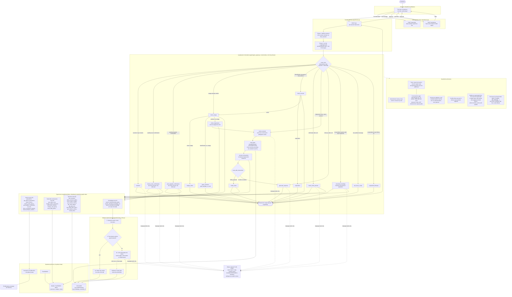

# ISPilot architecture

This document describes the system as implemented in this repository. Where something exists in the code but is not part of the live request path, it is marked as such.

## Full flow

## Key design decisions

**1. The LLM never chooses actions.** The graph is a state machine. Routing (`route_entry`, `route_after_account`, `route_after_outage`, `route_after_intervention`) and scenario selection are plain Python rules over keywords and diagnostic data. Interventions (reboot, password sync, MTU change, session disconnect) are fixed sequences per scenario, executed by `execute_intervention`. The model is limited to wording the reply, translating/reformulating retrieval queries, reranking retrieved passages, and choosing between a few labels in cases the rules cannot settle. Even that last choice is validated against a closed set (`general`, `wifi_confusion`, `slow_speed`, `high_latency`); anything else falls back to `general`.

**2. Diagnose first, always.** Before any decision, `collect_diagnostics` fetches a fresh snapshot (session history, authentication failures, device status and parameters, plan, retrieved procedure). Scenario selection reads that snapshot, not the model's memory of the conversation.

**3. Actions that cost money or disrupt service need a yes.** Factory reset and plan upgrade are two-step flows. The first turn asks and sets `awaiting_*` in the state; the next turn executes only if the customer explicitly confirms.

**4. Replies are grounded in what ran.** The reply prompt receives the actual scenario and the actual result of the executed tools. The prompt forbids describing actions that were not performed, inventing phone numbers, or using internal jargon. For plan questions, speeds come from the RADIUS group definition via `get_group_plan_specs`, and prices come from the retrieved catalog entry, instead of from the model's recall.

**5. Retrieval is adaptive.** A plain semantic search runs first. Only when its top relevance is below a gate threshold does the system pay for an LLM query reformulation plus reranking. If the LLM step fails, it falls back to a cosine-threshold filter, and if the vector store is unreachable the tool returns an explicit `[RAG_UNAVAILABLE]` marker that the graph handles.

**6. Local by design.** LLM, embeddings, speech-to-text and text-to-speech all run in the local stack. There is no external API key anywhere in the project.

## What the tracing layer is, and what it is not

- **Implemented:** all tool outputs used for a decision live in the LangGraph state for the session; the gateway prints a per-turn audit line (scenario, intervention flag, pending confirmations); tool failures carry fixed error codes.
- **Present but not wired in:** `agent/logger.py` (`ConversationLogger`) can write one JSON file per session with the conversation and an ordered tool-call trace, and `agent/review_tool.py` is a reviewer helper for those files. The current `main.py` does not call the logger, so no JSON traces are produced out of the box.
- **Not implemented:** an automatic post-hoc check that the final text matches the executed actions. Consistency currently relies on points 1, 3 and 4 above plus the scripted scenarios in `test_scenarios*.py`.
